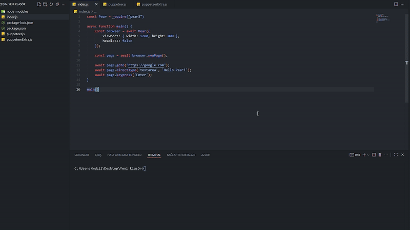
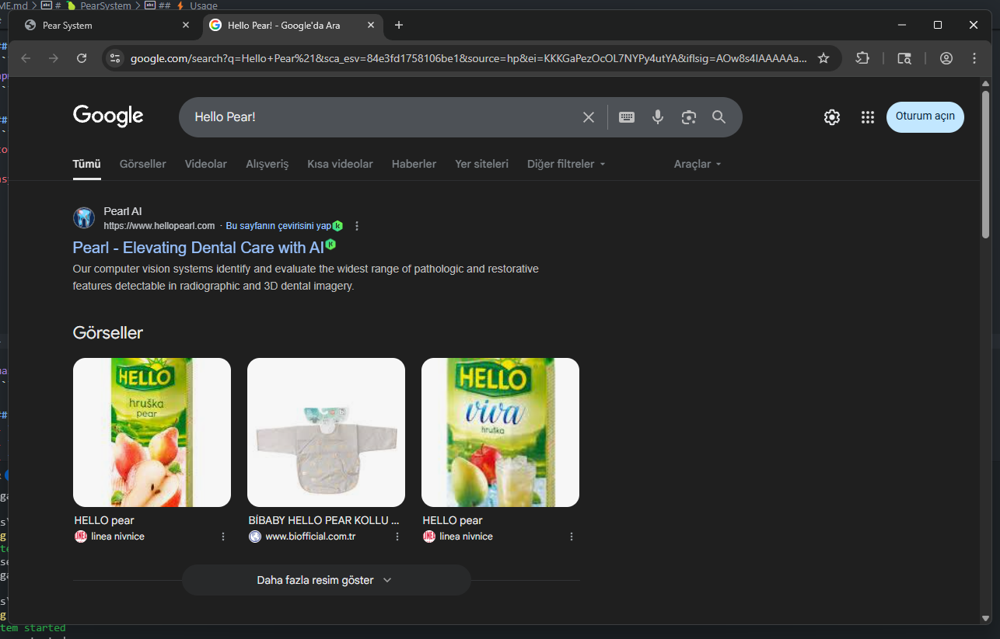

# 🍐 PearSystem

A Node.js-based automation framework that simplifies web automation, working with its own Chromium-based browser and extension.



## ⚡️ Usage
```js
const Pear = require("pear3")

async function main() {
    const browser = await Pear({
        viewport: { width: 1280, height: 800 },
        headless: false
    });

    const page = await browser.newPage();

    await page.goto("https://google.com");
    await page.directType('textarea', 'Hello Pear!');
    await page.keypress('Enter');
}

main()
```
<br>


## 📦 Installation
```bash
npm install pear3
```


## 🚀 Features
- Automatic Chromium installation and launch
- Fast communication via WebSocket
- Simulate keyboard and mouse events
- Wait for and interact with dynamic content
- File upload, screenshot capture, fetch content and URL
- Comprehensive API: `goto`, `click`, `type`, `scroll`, `waitForSelector`, `uploadFile`, `getAttribute`, `getText`, `screenshot`, and more


## 🧩 API
- `goto(url)` → Navigate to page
- `click(selector)` → Click element
- `type(selector, text)` → Type into element
- `scroll(selector, {x, y})` → Scroll on page
- `waitForSelector(selector, options)` → Wait for element
- `uploadFile(selector, filePath)` → Upload file
- `getAttribute(selector, attr)` → Get attribute
- `getText(selector)` → Get element text
- `screenshot()` → Take screenshot


## ⚠️ Disclaimer & Ethical Use

PearSystem is designed for legitimate browser automation, end-to-end testing, and educational research.
- **Authorized Testing Only:** Only run automated scripts on websites that you own, maintain, or have explicit permission to test.
- **Respect Site Policies:** Always adhere to the target website's `robots.txt`, Terms of Service, and acceptable use policies.
- **No Malicious Use:** The developer is not liable for any unauthorized access, scraping, or misuse conducted using this software.

## 👨‍💻 Contribution
You can open pull requests and issues. All feedback is welcome!

## 📄 License
MIT
